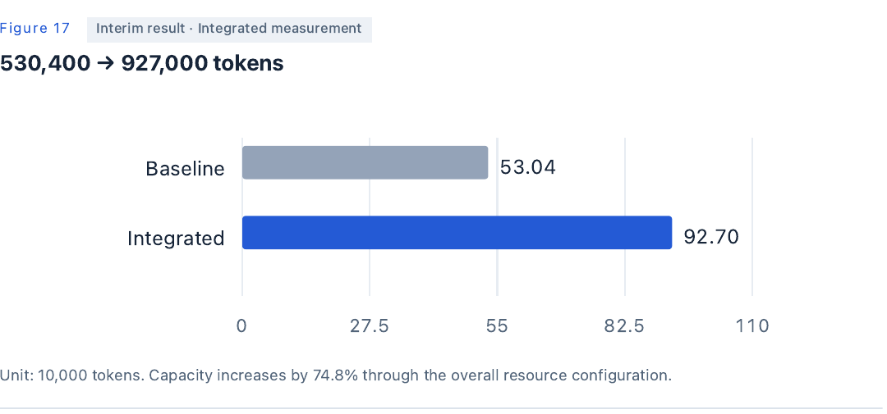
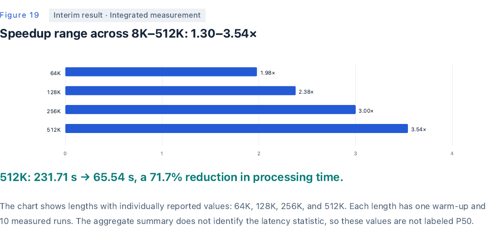
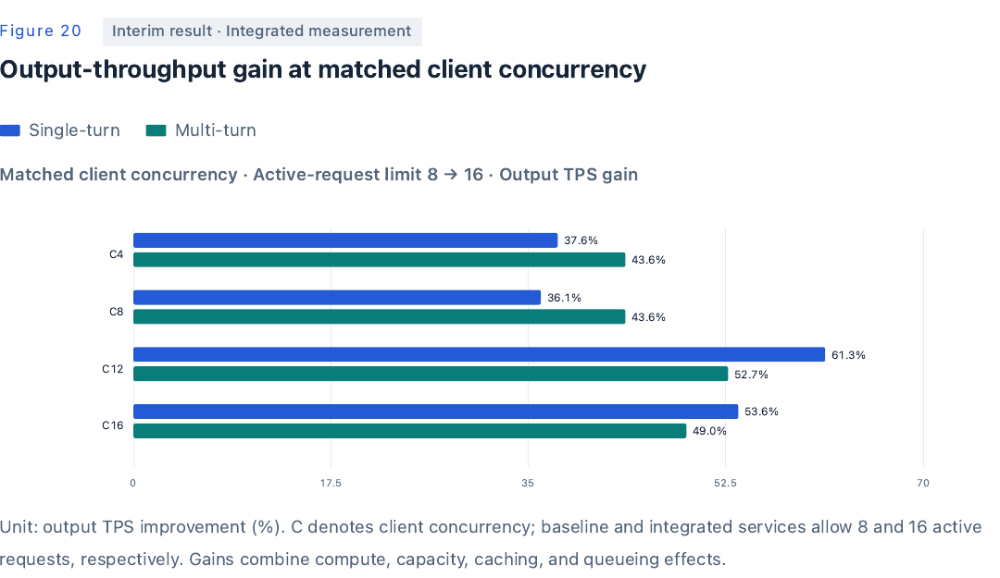
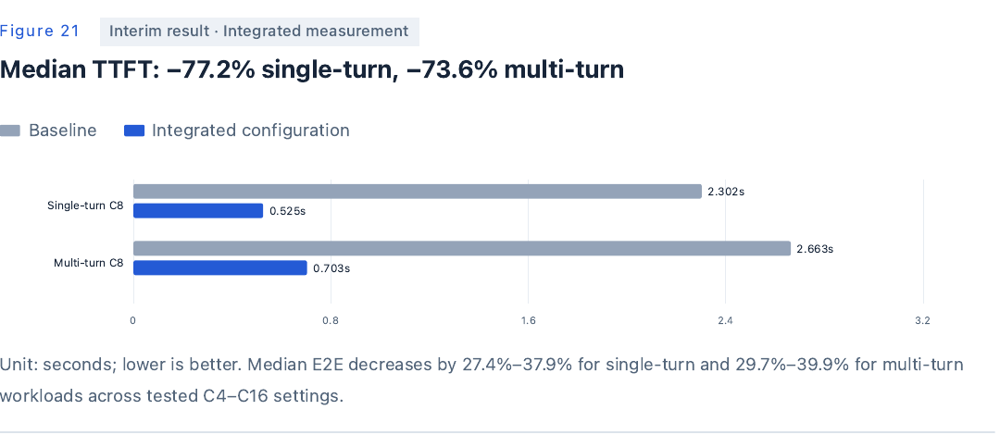

# Inference Framework Specialization: Methodology and Interim Results

English edition of revision v2 · November 13, 2026 · 32 pages

> This illustrated guide summarizes the supplied report. It is not a full-text transcription, a new benchmark run, or an independent validation. Read the [original PDF](PAPER.pdf) for the complete methodology, exact-value tables, component studies, and caveats.

## The specialization method

The report treats inference specialization as a continuous engineering process: identify bottlenecks for a specific hardware, interconnect, model, and workload combination; enable optimized execution paths only when their eligibility conditions hold; validate numerical behavior and performance; and retain compatible fallbacks. It builds on SGLang, rather than claiming to replace general-purpose serving frameworks.

The current phase evaluates Blackwell GPUs connected over PCIe without a faster GPU-to-GPU interconnect, constrained GPU memory, a deep hybrid-attention model, and long contexts. The example model has 64 layers: 16 full-attention layers with history-growing KV caches and 48 GDN layers with recurrent Mamba state. The paper separates local GPU memory reads, inter-GPU reductions, host-device KV restoration, compute, and queueing; those are different bottlenecks and should not be conflated.

## Six techniques in the current study

| Technique | Intended bottleneck or resource | Scope note |
| --- | --- | --- |
| FP4 attention compute | Long-context prefill computation | Short-input regressions and long-context quality changes are reported separately |
| GPU L2 weight prefetching | Weight-read waits during decode, overlapped with reduction windows | GPU L2 is not the second-tier KV pool; prefetch does not increase PCIe bandwidth |
| Operator shape/dispatch adaptation | Inefficient small-matrix paths at actual decode shapes | Local microbenchmarks are not production serving speedups |
| Cross-microbatch overlap (MBO) | Inter-GPU communication waits | Studied separately; not listed among the four confirmed integrated features |
| NVFP4 KV cache | KV storage per cached token | Capacity benefit depends on metadata, allocation, concurrency, and workload |
| BOLE recurrent-state optimization | Speculative candidate-state snapshots | Reclaimed memory can improve capacity, but some latency and quality trade-offs remain |

The report distinguishes component measurements from the later integrated comparison. It warns that individual gains are **not additive**.

## Confirmed integrated configuration and results

The confirmed integrated features are **BOLE, NVFP4 KV cache, FP4 prefill, and GPU L2 decode prefetching**. The comparison is a whole-system configuration change: client concurrency is matched, but the maximum active-request limit rises from 8 to 16. Compute, cache behavior, capacity, and queueing can all contribute. Feature-by-feature attribution under identical resource settings remains future validation work.

| Interim integrated measurement | Baseline | Integrated | Reported change |
| --- | ---: | ---: | ---: |
| GPU KV capacity | 530,400 tokens | 927,000 tokens | +74.8% |
| 512K cold-prefill processing | 231.71 s | 65.54 s | 3.54x speedup; 71.7% less time |
| Single-turn output throughput | Matched client concurrency | Matched client concurrency | Peak +61.3% at C12 |
| Multi-turn output throughput | Matched client concurrency | Matched client concurrency | Peak +52.7% at C12 |
| Median TTFT, single-turn C8 | 2.302 s | 0.525 s | -77.2% |
| Median TTFT, multi-turn C8 | 2.663 s | 0.703 s | -73.6% |

*Figure 17 from the PDF: 530,400 to 927,000 cached tokens under the overall resource configuration.*

*Figure 19 from the PDF. The values for 64K, 128K, 256K, and 512K are 1.98x, 2.38x, 3.00x, and 3.54x. Each length had one warm-up and ten measured runs; the aggregate latency statistic is not identified as P50.*

*Figure 20 from the PDF. Baseline and integrated services allow 8 and 16 active requests, respectively; these gains combine multiple effects.*

*Figure 21 from the PDF. TTFT is not the same as total end-to-end latency or per-token decode time.*

## Limits, regressions, and validation still needed

- **Integrated quality acceptance is outstanding.** The integrated performance summary does not include a complete quality evaluation. Results from other configurations cannot substitute for it.
- **Component regressions matter.** The FP4 attention study reports approximately 3% P50 regression at 1K-2K inputs and a fixed LongBench v2 subset change from 64.50% to 63.50%. An operator-combination production replay fails its predefined GSM8K non-inferiority criterion, despite latency improvements.
- **Throughput and interaction latency trade off.** In the BOLE component study, expanding from 16 to 32 slots increases throughput at concurrency 32 while TPOT P50 rises from 9.87 ms to 14.95 ms.
- **Generalization is unproven.** The paper's current measurements apply to the evaluated Blackwell/PCIe/model/workload combination. Cross-GPU and cross-model coverage requires separate correctness and performance validation.
- **Reproducibility detail remains limited.** The report says the integrated summary omits full topology, software builds, parameters, and raw distributions; it consolidates existing measurements and does not rerun experiments.

The [complete PDF](PAPER.pdf) contains the detailed six-technique studies, all 22 figures, exact-value tables, validation priorities, and the distinction between conceptual diagrams and measured evidence.
